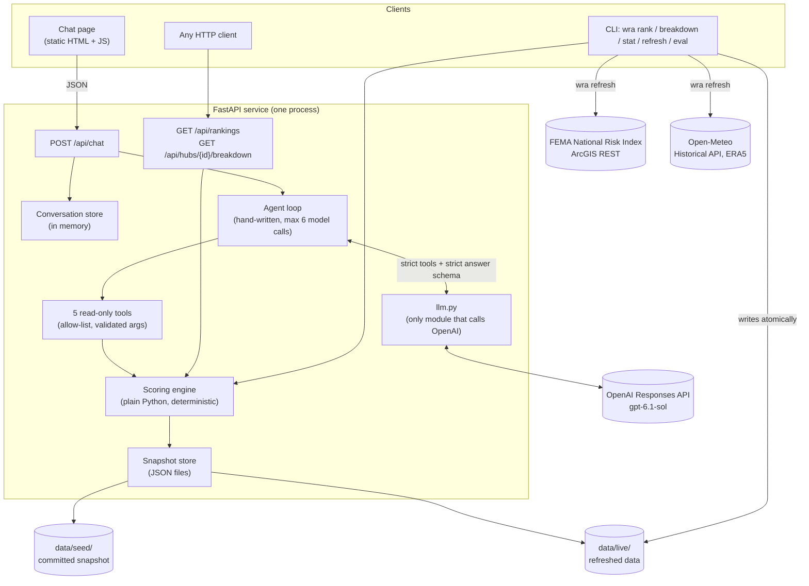

# Architecture: Weather Risk Intelligence Agent

## 1. System architecture

One Python process (FastAPI) with four layers. Each layer calls only the one below it. The scoring engine never imports the agent, so the deterministic engine is independent of the LLM.



### Components and how they talk

| Component | File | Talks to | How |
|---|---|---|---|
| Chat page | `api/static/index.html` | `POST /api/chat` | JSON over HTTP; renders text with `textContent` only |
| API | `api/app.py` | agent loop, engine, conversation store | in-process calls |
| Conversation store | `agent/conversations.py` | — | in-memory dict: last 20 turns, at most 200 conversations |
| Agent loop | `agent/loop.py` | `llm.py`, tools | Python calls; the loop owns the message history |
| LLM client | `agent/llm.py` | OpenAI Responses API | HTTPS; strict function tools plus a strict `text.format` JSON schema; `store=false` |
| Tools | `agent/tools.py` | engine | Python calls; return data, a code-built table, and sources |
| Scoring engine | `scoring/engine.py`, `indicators.py`, `stats.py` | snapshot store | Python calls; all scores computed once per snapshot |
| Snapshot store | `data/store.py` | JSON files | reads the live file if present, else the seed, per file; atomic writes |
| Fetchers | `data/sources.py` | Open-Meteo, FEMA NRI | HTTPS; used **only** by `wra refresh`, never while answering |

### The flow of one chat message

1. **The page posts** `{conversation_id, message}`. The API validates the length (1–1,000 characters) and loads or creates the conversation.
2. **The loop sends** the history, the 5 tool definitions, and the answer schema to the model through `llm.py`.
3. **The model asks for a tool**, for example `rank_hubs(hazard="winter", region="Midwest")`. The loop:
   - checks the name against the allow-list,
   - validates the arguments with Pydantic,
   - calls the engine,
   - sends the rounded result back to the model.
4. **The model returns its final answer** as strict JSON (narrative, assumptions, limitations, confidence). Pydantic validates it again. If it's invalid, the loop retries once, then returns a user-safe error.
5. **Code builds the response:** the model's narrative, plus tables and data sources built from the tool results. The model never writes a number the user sees in a table. If a tool reported missing data, code lowers `confidence` from high to medium.
6. **The turn is saved** to the conversation, but only if it succeeded, so failed turns never pollute follow-ups.

### Why no agent framework

One agent with five read-only tools needs a loop of about 80 lines. A hand-written loop keeps every step visible and debuggable, and lets the provider be swapped. A framework such as LangGraph or the OpenAI Agents SDK would earn its place with multi-agent handoffs, durable long-running workflows, or human-approval steps, and none of those are in scope.

## 2. Repository structure

```text
config/hubs.toml               16 hubs (id, city, coordinates, county FIPS) + state→region map
data/seed/                     committed snapshot of real API responses (7.2 MB)
  manifest.json                retrieval dates, NRI version, window
  nri_counties.json            all 3,232 US counties, frequency columns only
  weather/<hub>.json           daily ERA5 2016-2025 per hub
src/weather_risk/
  settings.py                  env config (OPENAI_API_KEY, OPENAI_MODEL, DATA_DIR)
  hubs.py                      hub list and regions
  cli.py, __main__.py          `wra` / `python -m weather_risk`
  data/                        models, public API fetchers, snapshot store
  scoring/                     indicators, engine (scores, ranking, breakdown, compare), stats
  agent/                       schemas, llm (OpenAI), tools, prompts, loop, conversations
  api/                         FastAPI app + static chat page
evals/                         cases.yaml, run.py, results/*.json
tests/unit, tests/smoke        119 tests: test-first for scoring and statistics; smoke tests for API and CLI
specs/001-core-risk-agent/     spec, plan, research, data model, contracts, tasks (Spec Kit)
.specify/memory/constitution.md  project principles
docs/                          architecture (this file), decisions log, session log
```

## 3. Data storage choice

**JSON files on disk, held in memory at runtime. No database in this version.**

- **The seed must be plain files in git anyway**, so a fresh clone works offline with reproducible scores and evals.
- **The data is small and read-only while serving:** 16 hubs × 3,653 days, plus 3,232 counties. All scores are computed in about 0.3 seconds when the snapshot loads.
- **Nothing in this feature needs queries, history, or concurrent writers.** Conversations are deliberately in memory, because the spec says they need not survive restarts.
- **Refresh is safe without a database:** it writes each source to a temporary file and renames it into place, so a failed fetch never leaves a half-written file. The server notices the new `manifest.json` and rebuilds its scores.

**When to add a database.** SQLite, on a Railway volume, arrives with the planned risk-change alert feature. That feature needs **score history**, so a change can be detected and recorded. In production with several server instances, conversations and score history would move to Postgres, or Redis for the conversations, and refresh would become a scheduled job.

## 4. Deployment

The target is Railway: one long-lived service running `wra serve --host 0.0.0.0` (it reads `PORT`), with a volume mounted at `DATA_DIR` for refreshed data. A long-lived container was chosen over serverless because the app keeps state in memory and will run a background scheduler for alerts; see `docs/decisions.md`.
