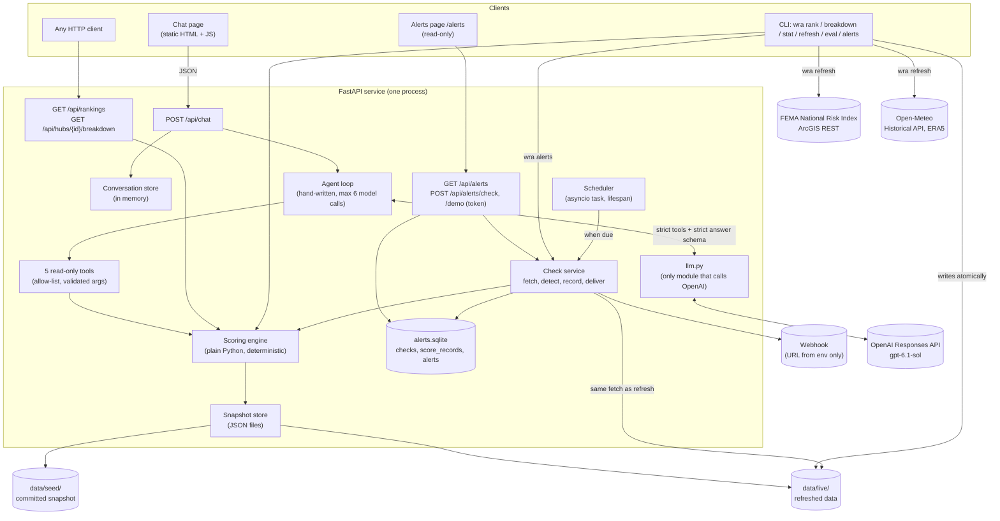

# Architecture: Weather Risk Intelligence Agent

## 1. System architecture

One Python process (FastAPI) with four layers, plus a risk-change alert job that runs inside the same process (feature 002). Each layer calls only the one below it. The scoring engine never imports the agent, so the deterministic engine is independent of the LLM.



### Components and how they talk

| Component | File | Talks to | How |
|---|---|---|---|
| Chat page | `api/static/index.html` | `POST /api/chat` | JSON over HTTP; renders text with `textContent` only |
| API | `api/app.py` | agent loop, engine, conversation store | in-process calls |
| Conversation store | `agent/conversations.py` | — | in-memory dict: last 20 turns, at most 200 conversations |
| Agent loop | `agent/loop.py` | `llm.py`, tools | Python calls; the loop owns the message history |
| LLM client | `agent/llm.py` | OpenAI Responses API | HTTPS; strict function tools plus a strict `text.format` JSON schema; `store=false` |
| Tools | `agent/tools.py` | engine | Python calls; return data, a code-built table, and sources |
| Scoring engine | `scoring/engine.py`, `indicators.py`, `stats.py` | snapshot store | Python calls; all scores computed once per snapshot |
| Snapshot store | `data/store.py` | JSON files | reads the live file if present, else the seed, per file; atomic writes |
| Fetchers | `data/sources.py`, `data/refresh.py` | Open-Meteo, FEMA NRI | HTTPS; used **only** by `wra refresh` and the alert check, never while answering a chat message |
| Change detection | `alerts/detect.py` | engine | pure functions: watched scores (rounded as displayed), change ≥ threshold, demo shifts |
| Alert history | `alerts/history.py` | SQLite file on the volume | stdlib `sqlite3`, raw SQL; one transaction per check |
| Alert delivery | `alerts/notify.py` | webhook | JSON POST, 5 s timeout, 3 attempts; logs every alert; never logs the URL |
| Check service | `alerts/service.py` | refresh, engine, history, delivery | one check at a time (a lock) |
| Scheduler | `alerts/scheduler.py` | check service | asyncio task started in the FastAPI lifespan; off unless `ALERT_INTERVAL_HOURS > 0` |

### The flow of one chat message

1. **The page posts** `{conversation_id, message}`. The API validates the length (1–1,000 characters) and loads or creates the conversation.
2. **The loop sends** the history, the 5 tool definitions, and the answer schema to the model through `llm.py`.
3. **The model asks for a tool**, for example `rank_hubs(hazard="winter", region="Midwest")`. The loop:
   - checks the name against the allow-list,
   - validates the arguments with Pydantic,
   - calls the engine,
   - sends the rounded result back to the model.
4. **The model returns its final answer** as strict JSON (narrative, assumptions, limitations, confidence). Pydantic validates it again. If it's invalid, the loop retries once, then returns a user-safe error.
5. **Code builds the response:** the model's narrative, plus tables and data sources built from the tool results. The model never writes a number the user sees in a table. If a tool reported missing data, code lowers `confidence` from high to medium.
6. **The turn is saved** to the conversation, but only if it succeeded, so failed turns never pollute follow-ups.

### The flow of one risk-change check (feature 002)

1. **Trigger:** the scheduler (when a check is due, computed from SQLite so redeploys neither skip nor repeat one), `wra alerts check`, or `POST /api/alerts/check` with the operator token.
2. **Fetch** live data into `DATA_DIR` exactly like `wra refresh`. A failed source keeps its old data and is recorded.
3. **Recompute** with the unchanged engine, and round each hub's overall and five hazard scores to one decimal, as they are displayed.
4. **Compare** with the last successful real check. A change of at least `ALERT_THRESHOLD` (2.0 points) is an alert. The first check records a baseline.
5. **Record** the check, its 96 scores, and its alerts in one SQLite transaction.
6. **Log and deliver** each alert to the webhook, and store the delivery status. A failed delivery never stops the check.

The demo (`wra alerts demo`, `POST /api/alerts/demo`, `scripts/alert_demo.py`) skips the fetch and compares today's real scores with a simulated previous set (Dallas heat 7.5 lower, Houston hurricane 5.0 higher). Its 2 alerts are labeled `demo`, and it writes no score history, so the next real check is unaffected. The agent has no tool that reaches any of this.

### Why no agent framework

One agent with five read-only tools needs a loop of about 80 lines. A hand-written loop keeps every step visible and debuggable, and lets the provider be swapped. A framework such as LangGraph or the OpenAI Agents SDK would earn its place with multi-agent handoffs, durable long-running workflows, or human-approval steps, and none of those are in scope.

## 2. Repository structure

```text
config/hubs.toml               16 hubs (id, city, coordinates, county FIPS) + state→region map
data/seed/                     committed snapshot of real API responses (7.2 MB)
  manifest.json                retrieval dates, NRI version, window
  nri_counties.json            all 3,232 US counties, frequency columns only
  weather/<hub>.json           daily ERA5 2016-2025 per hub
src/weather_risk/
  settings.py                  env config (OPENAI_API_KEY, OPENAI_MODEL, DATA_DIR)
  hubs.py                      hub list and regions
  cli.py, __main__.py          `wra` / `python -m weather_risk`
  data/                        models, public API fetchers, snapshot store
  scoring/                     indicators, engine (scores, ranking, breakdown, compare), stats
  agent/                       schemas, llm (OpenAI), tools, prompts, loop, conversations
  api/                         FastAPI app + static chat page
  alerts/                      detect (pure), history (sqlite3), notify (webhook), service, scheduler
evals/                         cases.yaml, run.py, results/*.json
scripts/                       export_session.py, smoke_deploy.py, alert_demo.py
Dockerfile, railway.toml       Railway build (Dockerfile) and deploy config (healthcheck)
tests/unit, tests/smoke        200 tests: test-first for scoring and statistics; smoke tests for API and CLI
specs/001-core-risk-agent/     spec, plan, research, data model, contracts, tasks (Spec Kit)
specs/002-risk-change-alert/   the same for the risk-change alert
.specify/memory/constitution.md  project principles
docs/                          architecture (this file), decisions log, session log
```

## 3. Data storage choice

**JSON files on disk, held in memory at runtime. No database in this version.**

- **The seed must be plain files in git anyway**, so a fresh clone works offline with reproducible scores and evals.
- **The data is small and read-only while serving:** 16 hubs × 3,653 days, plus 3,232 counties. All scores are computed in about 0.3 seconds when the snapshot loads.
- **Nothing in this feature needs queries, history, or concurrent writers.** Conversations are deliberately in memory, because the spec says they need not survive restarts.
- **Refresh is safe without a database:** it writes each source to a temporary file and renames it into place, so a failed fetch never leaves a half-written file. The server notices the new `manifest.json` and rebuilds its scores.

**SQLite for the alert history (feature 002).** The risk-change alert needs **score history**, so it uses one SQLite file, `DATA_DIR/alerts.sqlite`, on the Railway volume, with three tables:
- `checks`: one row per check (kind, time, outcome, fetch failures, data dates);
- `score_records`: 96 scores per real check, kept for the newest 30 real checks;
- `alerts`: old value, new value, change, a demo flag, and the delivery status.

It uses stdlib `sqlite3` with raw SQL, no ORM, and opens a new connection per operation, so the scheduler thread and request threads never share one. Each check is one transaction, so a crash never leaves half a check. A database fits here, where JSON files did not: the alert job needs a "last successful real check" query, appends history from two threads, and must survive redeploys. In production with several server instances, conversations and score history would move to Postgres, or Redis for the conversations, and refresh would become a scheduled job.

## 4. Deployment

Railway runs one long-lived service, built from the `Dockerfile` (`python:3.12-slim` plus a pinned uv) and started with `python -m weather_risk serve --host 0.0.0.0` (it reads `PORT`). `railway.toml` sets the healthcheck (`/api/health`). A volume mounted at `/data` (`DATA_DIR`) holds refreshed data and `alerts.sqlite`. Railway does not allow replicas with a volume, which matches the single-instance design: in-memory conversations and rate limits, and one scheduler. Variables: `OPENAI_API_KEY`, `DATA_DIR`, `TRUSTED_IP_HEADER=X-Real-IP` (the rate limiter keys on the client IP the proxy reports), `ALERT_INTERVAL_HOURS=24`, `ALERT_WEBHOOK_URL`, `ALERT_ADMIN_TOKEN`. A long-lived container was chosen over serverless because the app keeps state in memory and runs a background scheduler for alerts (verified live: the scheduled baseline check ran after startup, and alerts survived a redeploy); see `docs/decisions.md`.
